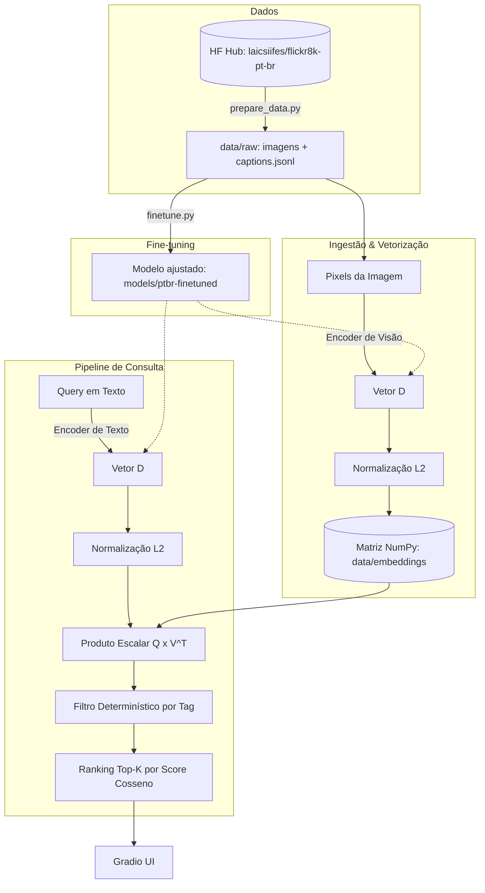

# VisioVetor — Engine de Busca Semântica Multimodal

Engine de busca vetorial multimodal em **Python** + **PyTorch** + **Hugging Face Transformers**, usando o **SigLIP 2 (`google/siglip2-base-patch16-224`)** para mapear imagens e textos em um espaço latente compartilhado de **768 dimensões**. O código funciona com qualquer modelo da família CLIP/SigLIP do Hub (ex.: `openai/clip-vit-base-patch32`), trocando `VISIOVETOR_BASE_MODEL`.

O projeto inclui um **fine-tuning contrastivo** com legendas em **português** (Flickr8k PT-BR).

Funcionalidades:

* **Texto → Imagem**: busca no catálogo por linguagem natural, com **filtro híbrido por tags**.
* **Imagem → Imagem**: busca por similaridade visual.
* **Imagem → Texto**: recupera as legendas mais próximas do catálogo e faz **classificação zero-shot** com rótulos livres.
* **Base × Fine-tuned**: compara os dois modelos lado a lado, com as métricas do treino.
* Interface com tema **Claro / Escuro** (seletor no topo, escolha salva no navegador; sem escolha, segue o sistema) e layout responsivo.

---

## 🏗️ Arquitetura



---

## 📐 Fundamentação Matemática

### 1. Normalização L2

Para cada vetor $v \in \mathbb{R}^{D}$ extraído pelo modelo (visão ou texto), com $D = 768$ no SigLIP 2 base:

$$\hat{v} = \frac{v}{\lVert v \rVert_2} = \frac{v}{\sqrt{\sum_{i=1}^{D} v_i^2}}$$

### 2. Similaridade de cosseno = produto escalar

$$\text{sim}(q, v) = \frac{q \cdot v}{\lVert q \rVert \lVert v \rVert} \quad\Rightarrow\quad \text{sim}(\hat{q}, \hat{v}) = \hat{q} \cdot \hat{v}$$

O ranking do catálogo inteiro sai de uma única multiplicação de matrizes:

$$S = Q \cdot V^T, \qquad V \in \mathbb{R}^{N \times D},\; Q \in \mathbb{R}^{1 \times D}$$

### 3. Perda do fine-tuning

Para um lote de $B$ pares (imagem, legenda), com $\tau$ = temperatura aprendida (`logit_scale`) e $b$ = viés aprendido (`logit_bias`):

* **SigLIP (sigmoide)** — cada par é um problema binário independente:

$$\mathcal{L} = -\frac{1}{B}\sum_{i,j} \log \sigma\big(z_{ij}\,(\tau\, \hat{t}_i \cdot \hat{v}_j + b)\big), \qquad z_{ij} = \begin{cases}+1 & i = j\\ -1 & i \neq j\end{cases}$$

* **CLIP (InfoNCE simétrica)** — usada quando o modelo base é um CLIP:

$$S = \tau \cdot \hat{T} \hat{I}^T, \qquad \mathcal{L} = \tfrac{1}{2}\big[\text{CE}(S, y) + \text{CE}(S^T, y)\big], \quad y = (0, 1, \dots, B-1)$$

Nos dois casos, a diagonal contém os pares corretos e o resto do lote funciona como negativos.

---

## 🎯 Modelo e fine-tuning

### Por que SigLIP 2?

A primeira versão usava o CLIP original da OpenAI (`openai/clip-vit-base-patch32`), treinado quase só em inglês. Buscas como "um gato" traziam cachorros e "duas pessoas se abraçando" trazia artes marciais. Trocar por um modelo **multilíngue** foi a maior melhora, maior que qualquer fine-tuning:

| Validação (1000 imagens, 5000 legendas; treino com 6000 imagens) | CLIP B/32 | CLIP B/32 ajustado | SigLIP 2 base | **SigLIP 2 ajustado** |
|---|---:|---:|---:|---:|
| Texto→Imagem R@1 | 10,8 | 28,4 | 66,2 | **72,1** |
| Texto→Imagem R@5 | 25,2 | 56,3 | 87,6 | **91,7** |
| Texto→Imagem R@10 | 34,1 | 69,5 | 93,3 | **96,1** |
| Imagem→Texto R@1 | 25,2 | 40,6 | 82,5 | **87,9** |
| Imagem→Texto R@5 | 47,1 | 71,4 | 96,0 | **97,6** |
| Imagem→Texto R@10 | 56,3 | 81,1 | 98,5 | **99,0** |

*R@K = % de consultas em que o item correto aparece entre os K primeiros.*

> Todas as colunas foram medidas na mesma validação. O CLIP ajustado é da primeira versão do projeto (treinado com 2000 imagens). Um SigLIP 2 ajustado só com 2000 imagens chega a 70,8 de R@1 texto→imagem: triplicar os dados rendeu +1,3 ponto. A validação maior (1000 imagens em vez de 300) deixa a tarefa mais difícil, por isso os números são menores que os de versões anteriores deste README.

### Como ler o ganho do fine-tuning

O R@1 texto→imagem foi de **66,2% para 72,1%** (+5,9 pontos). Em pontos parece pouco, mas o modelo base já acertava 2 de cada 3 buscas: o que importa é quanto do **erro que sobrava** foi eliminado.

| Métrica | Erro do base | Erro do ajustado | Erros eliminados |
|---|---:|---:|---:|
| Texto→Imagem R@1 | 33,8% | 27,9% | **−18%** |
| Texto→Imagem R@10 | 6,7% | 3,9% | **−42%** |
| Imagem→Texto R@1 | 17,5% | 12,1% | **−31%** |

Por que o ganho é limitado (e esperado):

* **O ponto de partida já é forte.** O SigLIP 2 foi pré-treinado em bilhões de pares imagem-texto em vários idiomas, incluindo português. O ajuste não ensina o idioma; só aproxima o modelo do estilo das legendas do Flickr8k ("um menino de camisa vermelha pula na piscina").
* **Pouco dado.** 6000 imagens é muito pouco perto do pré-treino. A curva confirma que já estamos perto do teto desse volume: triplicar os dados (2000 → 6000) rendeu só +1,3 ponto.
* **Ajuste leve, de propósito.** O encoder de visão fica congelado e só as últimas 4 camadas do texto treinam. Isso evita *catastrophic forgetting* (perder o conhecimento geral do pré-treino) e permite treinar em CPU.
* **A maior parte do ganho vem na 1ª época.** R@1: 66,2 → 71,1 (época 1) → 71,8 → 72,1 → 72,1. Depois disso o modelo satura, então mais épocas não ajudam.

Comparação útil: no CLIP original, que quase não entende português, o mesmo fine-tuning foi de 10,8 para 28,4 de R@1 (2,6×). Fine-tuning rende muito quando o modelo não conhece o domínio e pouco quando já conhece. Por isso **trocar o modelo base foi a decisão mais importante do projeto**, e o ajuste é o refinamento final.

Próximos passos que devem render mais que mais épocas: liberar algumas camadas finais do encoder de visão, usar *hard negatives* (legendas parecidas de imagens diferentes no mesmo lote) e treinar com uma base maior (ex.: Flickr30k com legendas em português, ~4× mais imagens).

### Estratégia de fine-tuning

Leve, para rodar **em CPU em ~23 minutos** com as 6000 imagens de treino (fora a vetorização inicial das imagens):

| Componente | Status |
|---|---|
| Encoder de visão completo | ❄️ congelado — vetores de imagem calculados uma vez e mantidos em cache |
| Últimas 4 camadas do encoder de texto | 🔥 treinável |
| Layer norm final + cabeça do texto | 🔥 treinável |
| Temperatura (`logit_scale`) e viés (`logit_bias`) | 🔥 treinável |

A cada época, uma das 5 legendas de cada imagem é sorteada (augmentation textual). O melhor checkpoint na validação é salvo em `models/ptbr-finetuned/` junto com `metrics.json`, e **só se superar o modelo base**.

Hiperparâmetros ajustáveis:

```bash
python scripts/finetune.py --epochs 4 --text-layers 4 --lr 1e-5 --batch-size 64
# outro modelo base (qualquer CLIP/SigLIP do Hub):
VISIOVETOR_BASE_MODEL=openai/clip-vit-base-patch32 python scripts/finetune.py
```

---

## 🤵 Persona Jeffrey

O **Jeffrey** é o assistente do VisioVetor: **cordial, educado e honesto**. Ele cumprimenta com gentileza, explica com clareza, só cita números que vêm do sistema e recusa com educação o que foge do escopo (reconhecimento facial, diagnóstico, inventar métricas).

### No app: o painel do Jeffrey

Acima de cada galeria, o Jeffrey explica a busca que acabou de rodar:

* **o que ele fez**: virou a frase ou a foto em vetor, comparou com o catálogo, aplicou o filtro de tags (e quantas imagens sobraram) e quanto tempo levou;
* **como ler o resultado**: se o 1º lugar se destaca ou está empatado, quais termos da busca aparecem nas legendas, qual tag ajuda a restringir;
* no zero-shot, se o modelo está confiante ou dividido entre rótulos; na comparação, se os dois modelos concordam.

O texto é gerado por regras a partir dos números reais da busca (`src/jeffrey.py`), sem LLM, então não inventa nada.

### Converse com o Jeffrey

Logo abaixo da fala dele há um chat. Ele lembra da última busca de cada aba e responde com os números dela:

* **sobre o resultado**: "por que essa foi a primeira?", "e a terceira?", "o que significa o score?", "quais tags aparecem?", "o que você fez?";
* **quando não agradou**: "não era isso" traz sugestões tiradas de legendas reais do catálogo;
* **sobre o catálogo**: "tem foto de gato?" conta as legendas de verdade (e admite quando não há nenhuma);
* **pedindo uma busca**: "busca um cachorro na neve" roda a busca, atualiza a galeria e o painel (abas Texto → Imagem e Base × Ajustado);
* **dúvidas gerais**: projeto, conceitos de IA, erros comuns e limites, respondidas a partir dos datasets da persona. A pergunta mais parecida é achada por TF-IDF de palavras e trigramas (aguenta erro de digitação); se nada for parecido o bastante, ele diz que não entendeu em vez de chutar.

Perguntas específicas (posição, "qual tem X", catálogo, pedidos de busca) são respondidas por regras, na hora e sem erro (`src/jeffrey_chat.py`). As abertas ("qual o score máximo possível?", "esse resultado é bom?") vão para um **LLM local** (`src/jeffrey_llm.py`, padrão **Qwen2.5-3B-Instruct**), que recebe os fatos do projeto, as faixas de score medidas no índice, a última busca e as respostas parecidas dos datasets (busca semântica com MiniLM multilíngue). O começo fixo do prompt fica em cache, então em CPU o primeiro texto aparece em ~4 s, com streaming.

| `VISIOVETOR_JEFFREY_LLM` | |
|---|---|
| *(padrão)* `Qwen/Qwen2.5-3B-Instruct` | ~6 GB, ~6 tokens/s em CPU; o melhor nos testes |
| `Qwen/Qwen2.5-1.5B-Instruct` | ~3 GB, 2x mais rápido, mas erra mais ao ler os resultados |
| `off` | sem LLM: só as regras (o app abre sem baixar nada) |

O modelo carrega em segundo plano; até ele ficar pronto (ou se falhar), o chat usa as regras.

### Datasets para treinar um LLM com a persona

```bash
python scripts/generate_dataset.py                 # gera tudo em data/processed/
python scripts/generate_dataset.py --dpo-max 400   # mais pares de preferência
```

São cerca de **700 conversas** e **270 pares de preferência**, em três origens:

* **escritos à mão**: identidade, conhecimento do projeto, limites, suporte técnico, conceitos de IA, segurança contra manipulação e instruções. Muitas perguntas aparecem de várias formas;
* **a partir dos dados reais**: buscas feitas nos índices de vetores, com os scores verdadeiros: explicação de resultados, imagens parecidas, legendas e zero-shot, refinamento de buscas vagas com legendas do catálogo, contagens por tag ("tem foto de girafa?" → "não encontrei nenhuma") e comparação base × ajustado. Usam o **mesmo narrador do painel**;
* **preferências (DPO)**: pares escritos à mão e rejeições geradas a partir das boas respostas (grosseria, nome errado, números inventados, emojis, inglês, certeza exagerada).

A lista completa, com contagens e formatos, fica em [`data/processed/README.md`](data/processed/README.md), gerado junto com os dados. Os números citados vêm de `metrics.json` e do catálogo; depois de re-treinar, basta rodar o gerador de novo. O script valida tudo: ordem das mensagens, respostas vazias, nome errado, emojis e placeholders.

### Treinar o Jeffrey (LoRA)

```bash
pip install -r requirements-llm.txt
python scripts/train_jeffrey.py                    # SFT com LoRA no Qwen2.5 0.5B Instruct
python scripts/train_jeffrey.py --dpo              # SFT e depois DPO
python scripts/train_jeffrey.py --max-steps 5      # teste rápido do pipeline
```

O adaptador fica em `models/jeffrey-lora/`, e no final o script mostra as respostas do modelo para algumas perguntas de teste. Em CPU, o treino completo leva horas; com GPU, minutos.

---

## 📁 Estrutura do Projeto

```text
visiovetor/
├── README.md
├── requirements.txt
├── requirements-llm.txt       # Extras para treinar o LLM (trl, peft)
├── config.py                  # Caminhos, modelo, dataset, device, tags
├── run.sh / run.bat           # Setup + dados + fine-tuning + índice + UI
├── app.py                     # Interface Gradio
├── scripts/
│   ├── prepare_data.py        # Baixa subconjunto do Flickr8k PT-BR (streaming)
│   ├── finetune.py            # Fine-tuning contrastivo + avaliação antes/depois
│   ├── build_index.py         # Vetoriza o catálogo para cada modelo
│   ├── generate_dataset.py    # Gera os JSONLs da persona Jeffrey (SFT, instrução, DPO)
│   └── train_jeffrey.py       # LoRA (SFT + DPO) de um LLM pequeno com a persona
├── data/
│   ├── raw/                   # images/ + captions.jsonl
│   ├── processed/             # JSONLs da persona Jeffrey (SFT, instrução, DPO)
│   └── embeddings/            # Cache .npy + .json dos índices
├── models/
│   ├── ptbr-finetuned/        # SigLIP 2 ajustado (gerado; usado pelo app)
│   └── clip-ptbr/             # CLIP B/32 ajustado da 1ª versão (só referência da tabela; o app não usa)
└── src/
    ├── __init__.py
    ├── embeddings.py          # Encoder CLIP/SigLIP: inferência, normalização L2, zero-shot
    ├── vector_store.py        # Busca vetorial NumPy + filtro por tags + persistência
    ├── catalog.py             # Construção/cache dos índices por modelo
    ├── data.py                # Leitura do catálogo e extração de tags
    ├── persona.py             # Persona Jeffrey: prompt de sistema e fatos do projeto
    ├── jeffrey.py             # Narrador: explicações do painel (e dos datasets)
    ├── jeffrey_chat.py        # Chat com o Jeffrey: regras (contexto da busca, catálogo, base de conhecimento)
    ├── jeffrey_llm.py         # Chat com o Jeffrey: LLM local com os fatos reais (RAG + cache de prefixo)
    ├── persona_data/          # Construtores dos datasets: common, manual, grounded, dpo
    ├── ui_theme.py            # Tema Gradio (zinc + sky, Inter, claro/escuro) e blocos HTML
    ├── ui.css                 # Estilos da interface (abas em pílula, galeria, métricas)
    └── metrics.py             # Recall@K texto↔imagem
```

---

## ⚡ Instalação e Execução

Pré-requisitos: Python 3.10+ e:

* **~6 GB livres** para o essencial: dependências (~1,6 GB), dados (~0,5 GB), índices (~0,3 GB), SigLIP 2 base (1,5 GB), modelo ajustado (1,5 GB) e MiniLM (~0,5 GB);
* **+~6 GB** de disco e RAM equivalente para o LLM do chat (Qwen2.5-3B, ligado por padrão). Para não baixar, use `VISIOVETOR_JEFFREY_LLM=off`.

### Automático

```bash
./run.sh          # Linux/macOS
run.bat           # Windows
```

O script cria o `venv`, instala as dependências (PyTorch CPU se não houver GPU NVIDIA), baixa os dados, faz o fine-tuning (pule com `SKIP_FINETUNE=1`), gera os índices e abre a UI em http://127.0.0.1:7860.

### Manual

```bash
python3 -m venv venv && source venv/bin/activate
pip install -r requirements.txt

python scripts/prepare_data.py            # ~500 MB, Flickr8k completo: 6000 treino + 1000 val
python scripts/finetune.py                # ~25 min em CPU (6000 imagens)
python scripts/build_index.py             # vetoriza o catálogo
python app.py
```

### Usando suas próprias imagens

Coloque as imagens em `data/raw/images/` e monte `data/raw/captions.jsonl` com uma linha por imagem:

```json
{"image": "images/foto1.jpg", "captions": ["um gato dormindo no sofá"], "tags": ["gato"], "split": "train"}
```

Use `"split": "val"` para as imagens de avaliação. Os índices são reconstruídos automaticamente quando o catálogo muda (ou force com `python scripts/build_index.py --force`).

---

## ⚠️ Limitações

* O catálogo da UI inclui as imagens de treino; as métricas acima são medidas **somente** na validação.
* As legendas do Flickr8k PT-BR são traduções automáticas.
* Esses modelos não são adequados para biometria/reconhecimento facial.

## 📊 Complexidade & Roadmap

* **Atual (NumPy em memória):** busca $O(N \cdot D)$, $D = 768$ — bom até ~100 mil imagens.
* **Produção:** FAISS ou Qdrant com índice **HNSW** (busca ~$O(\log N)$).
* **Fine-tuning:** descongelar camadas finais do encoder de visão (GPU), LoRA via `peft`, mais dados (Flickr30k / COCO traduzidos).
* **Assistente:** carregar no chat do app o adaptador LoRA treinado com `scripts/train_jeffrey.py` (hoje o chat usa o Qwen2.5-3B sem ajuste + regras) e comparar com o modelo atual.
