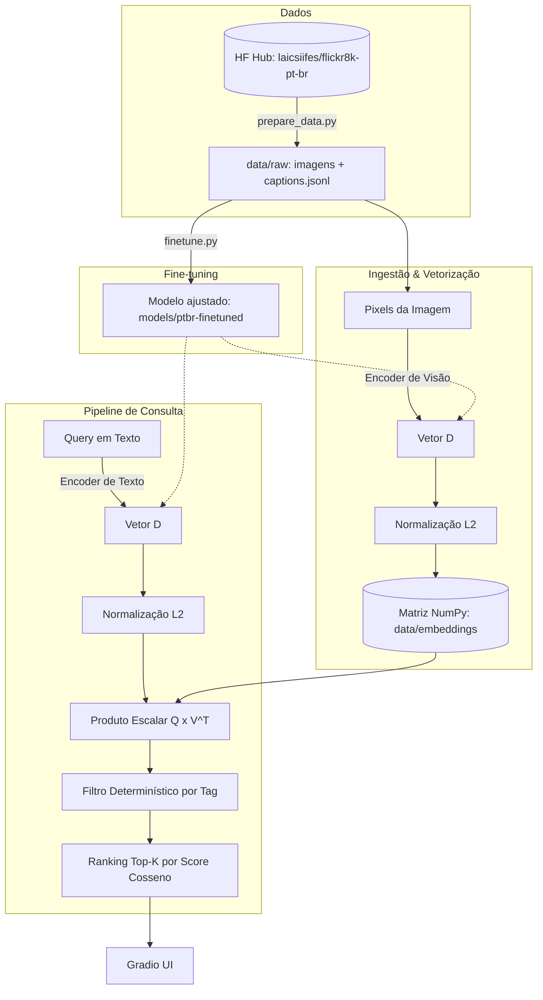

# 🔍 VisioVetor — Engine de Busca Semântica Multimodal

Engine de busca vetorial multimodal em **Python** + **PyTorch** + **Hugging Face Transformers**, usando o **SigLIP 2 (`google/siglip2-base-patch16-224`)** para mapear imagens e textos em um espaço latente compartilhado de **768 dimensões**. O código funciona com qualquer modelo da família CLIP/SigLIP do Hub (ex.: `openai/clip-vit-base-patch32`), trocando `VISIOVETOR_BASE_MODEL`.

O projeto inclui um **fine-tuning contrastivo** com legendas em **português** (Flickr8k PT-BR).

Funcionalidades:

* **Texto → Imagem**: busca no catálogo por linguagem natural, com **filtro híbrido por tags**.
* **Imagem → Imagem**: busca por similaridade visual.
* **Imagem → Texto**: recupera as legendas mais próximas do catálogo e faz **classificação zero-shot** com rótulos livres.
* **Base × Fine-tuned**: compara os dois modelos lado a lado, com as métricas do treino.
* Interface com tema **Claro / Escuro / Sistema** (seletor no topo, escolha salva no navegador) e layout responsivo.

---

## 🏗️ Arquitetura



---

## 📐 Fundamentação Matemática

### 1. Normalização L2

Para cada vetor $v \in \mathbb{R}^{D}$ extraído pelo modelo (visão ou texto), com $D = 768$ no SigLIP 2 base:

$$\hat{v} = \frac{v}{\lVert v \rVert_2} = \frac{v}{\sqrt{\sum_{i=1}^{D} v_i^2}}$$

### 2. Similaridade de cosseno = produto escalar

$$\text{sim}(q, v) = \frac{q \cdot v}{\lVert q \rVert \lVert v \rVert} \quad\Rightarrow\quad \text{sim}(\hat{q}, \hat{v}) = \hat{q} \cdot \hat{v}$$

O ranking do catálogo inteiro sai de uma única multiplicação de matrizes:

$$S = Q \cdot V^T, \qquad V \in \mathbb{R}^{N \times D},\; Q \in \mathbb{R}^{1 \times D}$$

### 3. Perda do fine-tuning

Para um lote de $B$ pares (imagem, legenda), com $\tau$ = temperatura aprendida (`logit_scale`) e $b$ = viés aprendido (`logit_bias`):

* **SigLIP (sigmoide)** — cada par é um problema binário independente:

$$\mathcal{L} = -\frac{1}{B}\sum_{i,j} \log \sigma\big(z_{ij}\,(\tau\, \hat{t}_i \cdot \hat{v}_j + b)\big), \qquad z_{ij} = \begin{cases}+1 & i = j\\ -1 & i \neq j\end{cases}$$

* **CLIP (InfoNCE simétrica)** — usada quando o modelo base é um CLIP:

$$S = \tau \cdot \hat{T} \hat{I}^T, \qquad \mathcal{L} = \tfrac{1}{2}\big[\text{CE}(S, y) + \text{CE}(S^T, y)\big], \quad y = (0, 1, \dots, B-1)$$

Nos dois casos, a diagonal contém os pares corretos e o resto do lote funciona como negativos.

---

## 🎯 Modelo e fine-tuning

### Por que SigLIP 2?

A primeira versão usava o CLIP original da OpenAI (`openai/clip-vit-base-patch32`), treinado quase só em inglês. Buscas como "um gato" traziam cachorros e "duas pessoas se abraçando" trazia artes marciais. Trocar por um modelo **multilíngue** foi a maior melhora, maior que qualquer fine-tuning:

| Validação (300 imagens, 1500 legendas) | CLIP B/32 | CLIP B/32 ajustado | SigLIP 2 base | **SigLIP 2 ajustado** |
|---|---:|---:|---:|---:|
| Texto→Imagem R@1 | 19,7 | 42,0 | 75,5 | **80,3** |
| Texto→Imagem R@5 | 41,5 | 74,5 | 95,0 | **97,3** |
| Texto→Imagem R@10 | 51,0 | 85,3 | 98,4 | **99,1** |
| Imagem→Texto R@1 | 34,7 | 54,7 | 89,3 | **90,3** |
| Imagem→Texto R@5 | 59,7 | 87,7 | 98,0 | **99,0** |
| Imagem→Texto R@10 | 70,3 | 93,3 | 99,7 | **99,7** |

*R@K = % de consultas em que o item correto aparece entre os K primeiros.*

### Estratégia de fine-tuning

Leve, para rodar **em CPU em ~7 minutos** (fora a vetorização inicial das imagens):

| Componente | Status |
|---|---|
| Encoder de visão completo | ❄️ congelado — vetores de imagem calculados uma vez e mantidos em cache |
| Últimas 4 camadas do encoder de texto | 🔥 treinável |
| Layer norm final + cabeça do texto | 🔥 treinável |
| Temperatura (`logit_scale`) e viés (`logit_bias`) | 🔥 treinável |

A cada época, uma das 5 legendas de cada imagem é sorteada (augmentation textual). O melhor checkpoint na validação é salvo em `models/ptbr-finetuned/` junto com `metrics.json`, e **só se superar o modelo base**.

Hiperparâmetros ajustáveis:

```bash
python scripts/finetune.py --epochs 4 --text-layers 4 --lr 1e-5 --batch-size 64
# outro modelo base (qualquer CLIP/SigLIP do Hub):
VISIOVETOR_BASE_MODEL=openai/clip-vit-base-patch32 python scripts/finetune.py
```

---

## 📁 Estrutura do Projeto

```text
visiovetor/
├── README.md
├── requirements.txt
├── config.py                  # Caminhos, modelo, dataset, device, tags
├── run.sh / run.bat           # Setup + dados + fine-tuning + índice + UI
├── app.py                     # Interface Gradio
├── scripts/
│   ├── prepare_data.py        # Baixa subconjunto do Flickr8k PT-BR (streaming)
│   ├── finetune.py            # Fine-tuning contrastivo + avaliação antes/depois
│   ├── build_index.py         # Vetoriza o catálogo para cada modelo
│   └── generate_dataset.py    # Dataset JSONL de persona (alinhamento de LLM)
├── data/
│   ├── raw/                   # images/ + captions.jsonl
│   ├── processed/             # JSONLs de comportamento/persona
│   └── embeddings/            # Cache .npy + .json dos índices
├── models/ptbr-finetuned/     # Modelo ajustado (gerado)
└── src/
    ├── embeddings.py          # Encoder CLIP/SigLIP: inferência, normalização L2, zero-shot
    ├── vector_store.py        # Busca vetorial NumPy + filtro por tags + persistência
    ├── catalog.py             # Construção/cache dos índices por modelo
    ├── data.py                # Leitura do catálogo e extração de tags
    ├── ui_theme.py            # Tema Gradio (zinc + sky, Inter, claro/escuro) e blocos HTML
    ├── ui.css                 # Estilos da interface (abas em pílula, galeria, métricas)
    └── metrics.py             # Recall@K texto↔imagem
```

---

## ⚡ Instalação e Execução

Pré-requisitos: Python 3.10+ e ~5 GB livres (dependências, dados, modelo base de 1,5 GB e o modelo ajustado).

### Automático

```bash
./run.sh          # Linux/macOS
run.bat           # Windows
```

O script cria o `venv`, instala as dependências (PyTorch CPU se não houver GPU NVIDIA), baixa os dados, faz o fine-tuning (pule com `SKIP_FINETUNE=1`), gera os índices e abre a UI em http://127.0.0.1:7860.

### Manual

```bash
python3 -m venv venv && source venv/bin/activate
pip install -r requirements.txt

python scripts/prepare_data.py            # ~150 MB, 2000 treino + 300 val
python scripts/finetune.py                # ~10-15 min em CPU
python scripts/build_index.py             # vetoriza o catálogo
python app.py
```

### Usando suas próprias imagens

Coloque as imagens em `data/raw/images/` e monte `data/raw/captions.jsonl` com uma linha por imagem:

```json
{"image": "images/foto1.jpg", "captions": ["um gato dormindo no sofá"], "tags": ["gato"], "split": "train"}
```

Use `"split": "val"` para as imagens de avaliação. Os índices são reconstruídos automaticamente quando o catálogo muda (ou force com `python scripts/build_index.py --force`).

---

## ⚠️ Limitações

* O catálogo da UI inclui as imagens de treino; as métricas acima são medidas **somente** na validação.
* As legendas do Flickr8k PT-BR são traduções automáticas.
* Esses modelos não são adequados para biometria/reconhecimento facial.

## 📊 Complexidade & Roadmap

* **Atual (NumPy em memória):** busca $O(N \cdot D)$, $D = 768$ — bom até ~100 mil imagens.
* **Produção:** FAISS ou Qdrant com índice **HNSW** (busca ~$O(\log N)$).
* **Fine-tuning:** descongelar camadas finais do encoder de visão (GPU), LoRA via `peft`, mais dados (Flickr30k / COCO traduzidos).
* **Assistente:** usar os JSONLs de `data/processed/` (persona "James") para ajustar um LLM pequeno que explique os resultados da busca.
